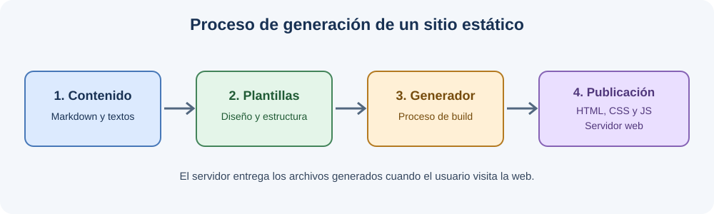

# Generadores de sitios estáticos

## ¿Qué es un SSG?

Un generador de sitios estáticos, conocido por sus siglas en inglés SSG (*Static Site Generator*), es un software que genera automáticamente las páginas HTML de una web a partir de archivos de contenido, plantillas y otros recursos.

La característica principal de estos sitios es que las páginas se generan antes de que el usuario acceda a ellas. Así, cuando alguien visita la web, el servidor puede entregar directamente los archivos HTML ya generados, sin tener que construir toda la página desde cero en cada petición.

El generador puede utilizar diferentes archivos, como contenido escrito en Markdown, plantillas, archivos de configuración, hojas de estilos CSS, JavaScript e imágenes. Todos estos elementos se procesan durante la construcción para generar los archivos que formarán nuestra página web estática.

Los SSG se utilizan, por ejemplo, para crear blogs, documentación técnica, páginas personales y sitios web de proyectos.

## ¿Cómo funciona un SSG?

El proceso de generación de una web estática se puede dividir en varios pasos:

1. **Crear el contenido:** se escribe el contenido de las páginas, normalmente utilizando Markdown o archivos HTML.
2. **Utilizar las plantillas:** las plantillas definen la estructura y el diseño que tendrán las páginas.
3. **Generar la web:** el SSG combina el contenido con las plantillas, la configuración y los recursos necesarios.
4. **Obtener los archivos finales:** se generan las páginas HTML y los recursos correspondientes, como CSS, JavaScript e imágenes.
5. **Publicar la web:** los archivos generados se suben a un servidor o servicio de alojamiento para que los usuarios puedan acceder a ellos.

Cuando un usuario visita la web, el servidor entrega los archivos generados. Si se modifica el contenido, normalmente hay que volver a ejecutar el proceso de construcción o `build` y publicar la nueva versión.

## Diferencias entre HTML manual y un SSG

| Aspecto | HTML manual | Generador estático (SSG) |
|---|---|---|
| Creación de páginas | Se escribe el HTML de cada página | Se utiliza contenido y plantillas |
| Diseño común | Puede ser necesario repetir código | Las plantillas permiten reutilizar la estructura |
| Actualizaciones | Se modifican los archivos manualmente | Se modifica el contenido y se vuelve a generar la web |
| Automatización | Depende del trabajo manual o de herramientas adicionales | El proceso de generación está automatizado |
| Conocimientos técnicos | Es necesario conocer HTML | Hay que aprender a utilizar el generador y sus plantillas |
| Uso habitual | Páginas sencillas | Blogs, documentación y webs con muchas páginas |

Un SSG resulta útil cuando una web tiene muchas páginas con una estructura común. Para una página muy sencilla, escribir el HTML manualmente puede ser suficiente.

## Comparación entre Jekyll, Hugo y Astro

| Aspecto | Jekyll | Hugo | Astro |
|---|---|---|---|
| Tecnología principal | Ruby | Go | JavaScript |
| Contenido y plantillas | Utiliza Markdown, HTML y plantillas Liquid | Utiliza Markdown y plantillas propias | Utiliza componentes Astro, Markdown y otros formatos compatibles |
| Funcionamiento | Combina el contenido con las plantillas y genera páginas HTML | Procesa el contenido y las plantillas para generar la web estática | Genera HTML a partir de sus componentes y contenido durante la construcción |
| Ventaja principal | Es adecuado para blogs y se integra con GitHub Pages | Destaca por su velocidad de generación | Permite crear webs modernas y enviar poco JavaScript al navegador cuando no es necesario |
| Inconveniente | Requiere un entorno con Ruby | Su sistema de plantillas puede necesitar aprendizaje | Requiere familiarizarse con su entorno y sus componentes |
| Uso habitual | Blogs y documentación | Blogs, documentación y webs con muchas páginas | Webs de contenido, sitios corporativos y proyectos con componentes interactivos |
| Publicación | Puede publicarse en GitHub Pages | Puede publicarse en distintos servicios de alojamiento | Puede publicarse en distintos servicios de alojamiento |

## Ventajas de los SSG

- **Rendimiento:** las páginas HTML ya están generadas y pueden servirse directamente.
- **Seguridad:** al no necesitar una base de datos ni ejecutar un CMS dinámico en cada petición, se reducen algunos riesgos.
- **Mantenimiento:** las plantillas permiten compartir elementos como la cabecera, el menú y el pie de página.
- **Portabilidad:** los archivos generados pueden alojarse en diferentes servicios compatibles con contenido estático.

## Limitaciones de los SSG

- **Actualización del contenido:** normalmente hay que volver a generar y publicar la web después de modificarla.
- **Conocimientos técnicos:** puede ser necesario aprender Markdown, plantillas, configuración y herramientas de construcción.
- **Contenido dinámico:** funciones como comentarios, cuentas de usuario o búsquedas avanzadas pueden requerir servicios externos o programación adicional.

## Esquema del proceso de generación

El siguiente esquema resume las principales fases de creación y publicación de un sitio estático:

[Vídeo explicativo sobre generadores de sitios estáticos](https://www.youtube.com/watch?v=osWfEtbP_sk)

[Ir al documento sobre CMS](cms.md)

